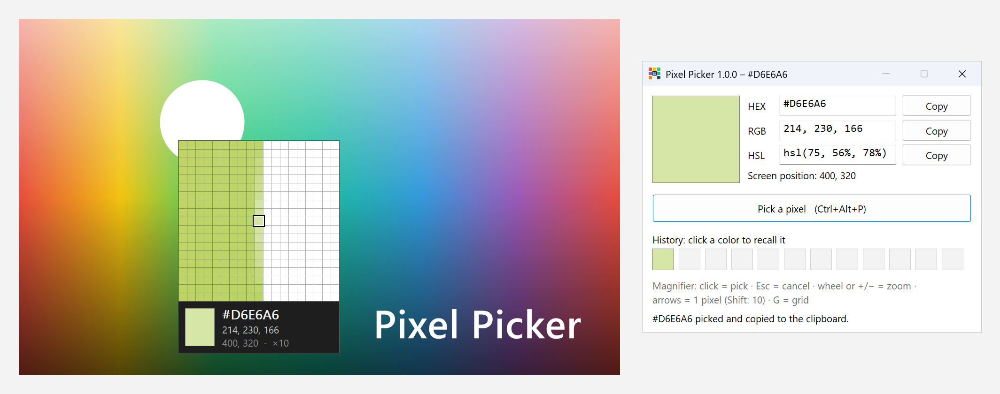

# Pixel Picker

A screen color picker for Windows: point at any pixel through a magnifier, click, and its
color is in the clipboard as HEX, with its RGB and HSL values one click away.

Made by [Ialto](https://ialto.com) and distributed under the Apache License 2.0 (see
[Licence](#licence)).



## Download

| Where | What | Kept |
|---|---|---|
| **Releases** (one per `vX.Y.Z` tag) | `PixelPicker-windows-x64.exe` | For good |
| **Actions**, a Build (or CI with "build") run started by hand, Artifacts | The same file, in `PixelPicker-Windows` | 90 days |

It is a single executable of about 210 KB, with no installer and nothing else to install. It
needs Windows 10 (version 1703 or later) or Windows 11, x64. It isn't signed: SmartScreen may
warn on the first start ("More info", then "Run anyway").

To publish a release, set the version in `Cargo.toml` (the window title and the executable's
properties show it), merge, then push the tag: `git tag v1.0.0 && git push origin v1.0.0`. The
Release workflow refuses a tag that doesn't match it.

## Picking a color

Click **Pick a pixel**, or press **Ctrl+Alt+P** from any application. The main window steps
aside, the screen freezes and the magnifier follows the cursor: the target pixel is ringed in
black and white, and the box below shows its color, its HEX and RGB values, its position and the
zoom.

| Key or button | Effect |
|---|---|
| Left click, `Enter` or `Space` | Picks the target pixel (with the button: when it is released, so the target can still be adjusted) |
| `Esc` or right click | Cancels |
| Mouse wheel, `+`, `−` | Zoom, ×3 to ×30 |
| Arrow keys (`Shift`: 10 pixels) | Moves the cursor by one pixel |
| `G` | Shows or hides the pixel grid |

The zoom and the grid are kept from one pick to the next. A pick copies the HEX code
(`#FF8000`) to the clipboard; the main window shows it with the RGB (`255, 128, 0`) and HSL
(`hsl(30, 100%, 50%)`) values, each with its **Copy** button. The last 12 colors are kept in
the history: clicking one makes it the current color and copies its HEX code again.

If the window was minimized when the shortcut was pressed, it stays minimized: the color goes
straight to the clipboard, and the title (shown in the taskbar) gives it. If another application
already holds Ctrl+Alt+P, the window says so and only the button starts picking. Only one Pixel
Picker runs at a time: starting it again brings the window forward.

## How it works

Picking starts with a screenshot of every monitor, shown frozen in a topmost window that
covers them all, and the magnifier is drawn over it. So:

- the value read is exactly the one that was displayed, and the magnifier never captures itself;
- the picking click goes to Pixel Picker, never to the application underneath;
- the target holds still, even over animated content.

Pixel Picker declares Per-Monitor V2 DPI awareness: it works in physical pixels, so one
magnifier cell is one screen pixel at any display scaling, and the magnifier is sized for the
monitor it is on.

## Build

Windows, Rust stable (1.88 or later) with the MSVC toolchain (`x86_64-pc-windows-msvc`, installed
with Visual Studio's C++ build tools), then:

```sh
cargo build --release
target\release\PixelPicker.exe
```

`build.rs` hands the MSVC linker the manifest (`pixel-picker.manifest`: DPI awareness, Common
Controls 6) and a resource file it writes itself: the icon in eight sizes, 16 to 256 px, and the
version details from `Cargo.toml` (shown in the file's properties and by Task Manager). No
resource compiler is needed.

Checks are run locally, before pushing; GitHub's CI minutes are kept for releases:

```sh
scripts/check.sh            # format, clippy and the tests
scripts/check.sh --release  # and the release build, started once (.github/scripts/smoke-test.ps1)
```

Nothing on GitHub runs by itself, neither for pull requests nor for pushes to `main`:

| Workflow | When | What |
|---|---|---|
| `release.yml` | A version tag `vX.Y.Z` | The checks (`ci.yml`), the build (`build.yml`), then the release |
| `ci.yml` | By hand: Actions, CI, Run workflow | Format, clippy and the tests on Windows; the build if ticked |
| `build.yml` | By hand: Actions, Build, Run workflow | The release build, started once, kept as the run's artifact for 90 days |

The start-up test checks the executable's version details against `Cargo.toml`, waits for the
main window and its title, then closes it and expects the program to exit.

## Code

Plain Win32 through [`windows-sys`](https://crates.io/crates/windows-sys), no GUI framework.

| Module | Role |
|---|---|
| `main.rs` | Entry point: DPI awareness, common controls |
| `app.rs` | The main window: values, copy buttons, history, global shortcut, single instance |
| `picker.rs` | Picking: the frozen full-screen window, mouse and keyboard, the magnifier box's text |
| `magnifier.rs` | The magnifier's geometry and pixels (pure code, tested) |
| `capture.rs` | 32-bit bitmaps and the capture of every monitor |
| `color.rs` | The color type, its HEX, RGB and HSL forms (tested) |
| `clipboard.rs` | Text to the clipboard |
| `icon_art.rs` | The icon's pixels, shared with `build.rs` (tested) |
| `icon.rs` | The window icons, drawn at the exact size the system asks for |
| `win.rs` | Small Win32 helpers |

The icon is a 3×3 grid of colored pixels whose center one is ringed like the magnifier's
target. It is drawn by code, `src/icon_art.rs`, rather than kept as a picture: the window icons
are drawn at run time at the exact size the system asks for, and `build.rs` draws the same
artwork for the executable, so they always match.

## Tests

```sh
cargo test
```

They cover the color forms (HEX, RGB, HSL conversion), the magnifier (odd cell counts at every
zoom and scaling, placement near the monitor's edges, the pixels drawn around a target, clipping)
and the icon's artwork. The windows themselves are checked by the start-up test.

## Known limitations

- **Windows only.** Everything below the color and magnifier code is Win32.
- **HDR and wide color gamut.** With Windows HDR on, the screen capture (GDI) returns values
  converted to 8-bit sRGB: colors brighter than SDR white or outside sRGB are clipped.
- **Protected content** (DRM video, for instance) is black in the capture, so in the magnifier.
- The history isn't kept after the program closes, and the shortcut can't be changed.

## Licence

Copyright 2026 Ialto. Pixel Picker is distributed under the Apache License, Version 2.0: see
[LICENSE](LICENSE) and [NOTICE](NOTICE). The Ialto name belongs to Ialto and isn't covered by
that licence.
